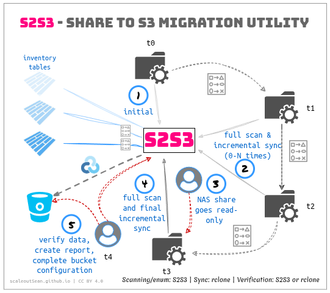

# S2S3 - Share-to-S3 tool for NAS migration to S3

- [S2S3 - Share-to-S3 tool for NAS migration to S3](#s2s3---share-to-s3-tool-for-nas-migration-to-s3)
  - [How it works](#how-it-works)
  - [Scale](#scale)
  - [Workflow](#workflow)
  - [Calibrate source and target](#calibrate-source-and-target)
  - [Build inventory](#build-inventory)
    - [Data set naming conventions](#data-set-naming-conventions)
    - [NFS v3 inventory](#nfs-v3-inventory)
    - [S3 inventory](#s3-inventory)
    - [Pre-flight checks](#pre-flight-checks)
    - [Build inventory after initial copy](#build-inventory-after-initial-copy)
    - [SMB inventory](#smb-inventory)
  - [Check NAS directory/file to S3 key mapping](#check-nas-directoryfile-to-s3-key-mapping)
  - [Copy NAS data to S3](#copy-nas-data-to-s3)
    - [Initial copy](#initial-copy)
    - [Sync - propagate source changes to S3](#sync---propagate-source-changes-to-s3)
  - [Export inventory](#export-inventory)
  - [Copy vs Sync](#copy-vs-sync)
  - [Verify](#verify)
  - [Report](#report)
  - [Other notes](#other-notes)
    - [Database vs dataset](#database-vs-dataset)
    - [Diff vs Verify (NAS-to-S3, Deep)](#diff-vs-verify-nas-to-s3-deep)
    - [Small scale checks](#small-scale-checks)
    - [One-shot copy example](#one-shot-copy-example)
    - [Pick your adventure (canned examples)](#pick-your-adventure-canned-examples)
  - [Privacy and T\&C](#privacy-and-tc)


S2S3 can help you quickly migrate small-to-medium NFSv3 and SMB shares to NetApp StorageGRID and Versity S3 Gateway with E-Series buckets. It has no restrictions and it is also very affordable - download it for free from Releases.

The initial implementation supports NFSv3 and SMB 3 sources. Other sources (SMB 2, NFSv4) may (SMB 2) or may not (NFSv4) work. I may add more later, but for now you can share the share using a supported protocol and limit client access to S2S3.

## How it works

S2S3 works the same way most people do this manually.



- t0 - create initial inventory and the first copy to S3 bucket
- t1, t2 - optional (full) inventory with incremental sync-copy
- t3 - make the NFS share read-only, ceate final full inventory of the source
- t4 - final incremental sync, verification run, optional creation of full inventory of both source and destination for compliance or record-keeping

As shown in the diagram, copy/sync operations are handled by an external utility, such as Rclone, but file lists can be passed to any program, making it possible to use highly specialized copy tools where required or beneficial.

S2S3 can implement copying, but that would reduce its flexibility. Flexibility seems more valuable than convenience, but convenience is retained by using one reference tool with canned examples for common workflows included in the S2S3 documentation. 

Why not just use Rclone? Rcone is more powerful, but it's also overwhelming. I want a handful clear steps without 50 options for each. Also, S2S3 does use Rclone, just not for the steps where Rclone is overkill.

## Scale

- NAS and S3 are expected to handle S2S3's requests
- S2S3 tested for key client-side characteristics:
  - Enumerate a NAS share with many millions of files
  - Enumerate a NAS directory with 500,000 files
  - Enumerate a bucket with millions of objects
  - Database/dataset operations are relatively light and not specifically tested for performance and scale

Even at a small scale, S2S3's inventory building (i.e. "share enumeration" and "bucket listing") speed is 8,000 files (NFS) and 3,000 objects (S3) per second.

Copy/sync performance depends on Rclone, not on S2S3, but in reality it is usually constrained by source and target performance.

S2S3 should be able to handle inventories for 100 TB NAS shares and NAS systems with several such shares, given that each source-destination pair is independent of others. It takes a long time to enumerate large buckets (especially if the object store is slower than S2S3 client) and very large directories, but it should complete enumeration within scenarios outlined above.

Some extra musings can be [found in my inaugural S2S3 blog post](http://scaleoutsean.github.io/2026/10/22/s2s3-share-to-s3-tool.html).

## Workflow

- Calibrate to find the optimal workload for NFS and S3
- Build inventory and perform the initial copy
  - Perform additional rounds of "full inventory + incremental sync" if needed
- Final full inventory on a *read-only* NAS export, and an incremental sync from NAS to S3
- Verification and (if needed) report
- Switch-over (S3 ACLs need to be  modified to allow S3 modify actions to other users)

## Calibrate source and target

On the client, S2S3's work is cheap. Servers' work is not. You need to carefully consider the workload S2S3 creates:

- On source: directory listing (inventory), reads (copy/sync)
- On target: Put (and some delete) workload (copy/sync), bucket enumeration (inventory, comparison, report)
- On S2S3 client: small workload (write/read Parquet DB files)

**NFS:** S2S3 lets you specify the number of threads used to scan a NAS share. Two is usually enough (lab testing shows 8,000 files listed per second), but can impact other NAS workloads, so try one thread as the minimum and evaluate more as necessary. Rclone, used to read data from the source (NAS share) lets you specify the number of threads used in copy/sync/verify`q operations. 

**S3:** S2S3's enumeration of S3 buckets is single-threaded and lab results show around 3,000 objects listed per second. If that level can impact your StorageGRID, ask your StorageGRID admin or other infrastructure person to configure [Traffic Classification](https://docs.netapp.com/us-en/storagegrid/admin/managing-traffic-classification-policies.html) for the S2S3 (tenant) account, the S2S3 IP, the bucket(s)...

**End-to-end:** Inventories are built separately, so they are not inter-dependent. For copy/sync, find balanced settings that work well with both the source and destination of migration. Put operations to S3 are likely going to be slower than NFS reads (especially with sub-1MiB NFS files), so Rclone shouldn't try to push harder than necessary - it won't work anyway.

## Build inventory

Source NAS share must be inventoried first. S3 inventory not until after the first copy from NAS is performed because it is assumed to be empty at start.

### Data set naming conventions

We use `--db <path>` to specify the location of an inventory database. It is suggested to employ a convention before starting a multi-step process (e.g. `<nas_ip>_<share_name>_<datetime>_<ref>` and `<s3-api>_<bucket_name>_<datetime>-<ref>`).

A date string (e.g. 2026-10-28-14) gives you an idea when the scan was performned, and your reference is an extra for easier identification.

### NFS v3 inventory

```sh
$ s2s3 inventory -h
Enumerate an NFSv3 export without following symlinks

Usage:
  s2s3 inventory nfs://host/export --db DIRECTORY [flags]

Flags:
      --db string               New local dataset directory (must not already exist)
      --db-temp-dir string      Temporary directory for the disk-spooled work queue
      --gid uint32              AUTH_SYS primary group ID (default 1000)
      --groups string           AUTH_SYS supplementary group IDs, comma-separated
  -h, --help                    help for inventory
      --missing-threshold int   Distinct missing siblings before checking their parent (default 5)
      --mount-port uint16       MOUNT TCP port; zero discovers through portmapper
      --nfs-port uint16         NFS TCP port; zero discovers through portmapper
      --reserved-port           Bind a reserved source port if required by export policy
      --row-group-rows int      Maximum rows per Parquet row group (default 8192)
      --rows-per-part int       Maximum rows per Parquet part (default 250000)
      --rpcbind-port uint16     RPC portmapper TCP port (default 111)
      --threads int             Concurrent directory listings (default 2)
      --timeout duration        TCP dial and individual RPC I/O timeout (not a directory time limit) (default 5s)
      --uid uint32              AUTH_SYS user ID (default 1000)
```

**Note:** NFS does not require a mount point at this stage, but OS requires a sudoer, which then results in root ownership of the `db` directory. If you operate S2S3 as a regular OS user, run `sudo chown <uid>:<gid> -R <db-directory>` after this step, so that you don't have to run subsequent steps as a sudoer. Rclone copy/sync requires a mounted NAS share, so you'll need `sudo` for make that happen, but not for any other S2S3 operations.

```sh
sudo s2s3 inventory nfs://192.168.1.194/mnt/nfs-test \
  --reserved-port --uid "$(id -u)" --gid "$(id -g)" \
  --db ./test-inc-01 --threads 2 --timeout 30s
```

After this, I choose to change data directory ownership to my user:

```sh
sudo chown -R sean:sean ./test-inc-01
```

If you don't want non-sudoers to be able to access this data, you can skip this step.

### S3 inventory

### Pre-flight checks

Different actions are required for different use of S3. You can try one or more of these before you fly.

```sh
# load S3 creds from .env or add AWS_ACCESS_KEY_ID=<str> AWS_SECRET_ACCESS_KEY=<str>
s2s3 preflight s3://bucket/prefix --mode list
s2s3 preflight s3://bucket/prefix --mode copy
s2s3 preflight s3://bucket/prefix --mode sync
```

To build an inventory you just need to be able to `list`. Later, as we copy and sync, we will need more. If you wanted to micro-manage, you could set up more than one tenant account.

**IMPORTANT NOTES:** 

- Use tenant root or designated migration account for S2S3.
- Non-S2S3 users should have very limited access - best none at all - to destination bucket during migration, with appropriate ACLs (not be wide-open to Anonymous or "any tenant account/user") issued to a different account (not the tenant admin or S23 user).
- You should also read **Copy vs. Sync** below, before you begin.

### Build inventory after initial copy

We don't need to build inventory of an empty bucket, so we'd do this only *after the first copy* from NAS to S3 has completed.

```sh
# load S3 creds from .env or add AWS_ACCESS_KEY_ID=<str> AWS_SECRET_ACCESS_KEY=<str>
s2s3 inventory s3://<bucket>/<prefix>/ \
  --s3-endpoint https://host:port \
  --s3-path-style --timeout 30s \
  --db <inventory-dir>
```

S2S3 needs the S3 credentials (that's not optional and should be verified with pre-flight checks). HTTPS port for StorageGRID S3 API is usually 10443 and Versity S3 Gateway defaults to 7070. Do not use HTTP here as not just TBs of data could leak, but your credentials could end up compromised as well.

### SMB inventory

Limited SMB support is available since v0.2.0:
- Windows Server 2025
- SMB 3.1.1 protocol only
- Windows (not Linux) SMB client
- UNC path is available, the S2S3 user is authenticated and has required permissions to access files in the share

```powershell
.\s2s3_windows_amd64.exe inventory '\\server\share' \
  --db .\smb-test-001 --threads 2
```

Shockingly, you can do this (if you don't mind to use up to 3x more time):

```powershell
 .\s2s3_windows_amd64.exe inventory nfs://192.168.1.194/mnt/nfs-test `
   --db 'c:\nfs-s194-004' `
   --threads 1 `
   --uid 1000 --gid 1000 --reserved-port
 ```

Windows support may be improved the future, depending on opportunities.

## Check NAS directory/file to S3 key mapping

Does your NAS share have weird names? Of course it does!

You should ask users to modify them on their own, but if it's too late for that, at least you can detect them beforehand:

```sh
s2s3 check-compat \
  --dataset ./smb-test-002 --target s3 \
  --target-prefix 'migration/' \
  --report ./compat-findings.jsonl \
  --strict
```

Strict checks include "you can do that, but it may break S3 apps" types of situations. For example, `\\192.168.1.25\s2s3share\test 日本\test.txt` would cause a warning due to a space in directory name.

Report highlights:

- Blockers: invalid UTF-8, keys exceeding 1,024 bytes.
- Warnings: names requiring special handling by downstream applications.
- Export limitations: names such as those containing newlines that our current file-list format cannot represent safely.

```json
{
  "dataset": "smb-001",
  "source_id": "//192.168.1.131/s2s3",
  "target": "s3",
  "target_prefix": "",
  "strict": true,
  "passed": true,
  "s3_compatible": true,
  "files_checked": 100010,
  "skipped_rows": 35,
  "affected_files": 0,
  "blockers": 0,
  "s3_blockers": 0,
  "export_limitations": 0,
  "warnings": 0,
  "counts": {},
  "examples": []
}
```

Please check the AWS S3 documentation on unsupported, and unrecommended characters in S3 key names.

**TIP:** Once the inventory database is ready, you can copy it to Linux and run the rest of it from Linux - `check-compat`, `export`, `diff`, and `verify --mode lite` (as this mode doesn't require native access to the share). On Linux, mount the same SMB 3 share read-only and use that mount as `--source-root`, with the same relative directory layout.

Otherwise, you could run other S2S3 commands on Windows as well; create Rclone configuration file, have Rclone ready and provide `--rclone-bin`, `--rclone-config` if you run the rest of the steps on Windows.

## Copy NAS data to S3

As mentioned at the top, S2S3 can give you lists of files that need to be copied (or deleted, if files have been deleted from the source). 

In Rclone, in the context of S2S3, there are two kinds although you can use just one:

- Copy: copies NAS share over S3 bucket contents.
- Sync: propagates changes from NAS share to S3.

We want to use `copy` first - since the destination bucket is empty, it won't be different from `sync` - but later on, it is less resource-intensive to use `sync`.

Subsequently, we can avoid re-copying of all NAS share content by using `sync`. "Conservative" users may use `copy` throughout, but iterative migrations done this way take longer.

Before you can either copy or sync, you need to mount the source NAS share. On Linux, that could be a path in your own directory. Examples below use `/tmp` which is convenient, but less secure as others may have access to the mount.

### Initial copy

The assumption is most users perform multiple rounds of synchronization, but this initial copy could also be the only one. If you're performing one-shot migration (no subsequent syncs), make your NAS share **read-only** before you begin this phase.

**Copy** data from NAS to S3 with `rclone copy`. You need to set up your S3 in Rclone configuration file (default: `~/.config/rclone/rclone.conf`) and use Rclone parameters determined during calibration. Or you can drop some options and let Rclone use its defaults.

**Note:** that Rclone works with NAS mounts, so mount that NFS share somewhere (requires a `sudoer` account). `/tmp/nfs-test` is convenient, but `/mnt/nfs-test` may be safer (depending on NFS export options and your OS environment).

```sh
rclone copy \
  /tmp/nfs-test \
  s131:dst \
  --no-traverse \
  --transfers 1 \
  --checkers 1 \
  --s3-upload-concurrency 1 \
  --s3-no-head \
  --tpslimit 5 \
  --tpslimit-burst 1 \
  --max-backlog 2 \
```

**If** your NAS was read-only, you could verify and be done:

```sh
# inventory the S3 target bucket after NAs-to-S3 sync
s2s3 inventory s3://dst --db ./s3-t0 ...

# compare
s2s3 verify --source ./test-t0 --target ./s3-t0
```

Most users leave NFS share in use and take time to examine the target, compare NAS share with S3 and may perform multiple rounds of "inventory & sync" to keep the size of the last sync smaller. That's next.

### Sync - propagate source changes to S3 

If your NFS share is still open for writing by now, you can perform checks on the target, compare files, and so on.

**Sync** data with `rclone sync`. To know what to sync, we use `s2s3 diff` with two inventory data sets: `--before` is the previous, and `--after` is the updated (latest, named `test-inc-01`):

```sh
s2s3 diff --before ./test-t0 --after ./test-inc-01 \
  --copy-list ./test-inc-01-copy-filelist.txt \
  --delete-list ./test-inc-01-delete-filelist.txt
```

This gives me two lists:
- copy-list: changed and added
- delete-list: deleted

This is now easy to process with Rclone. Use `rclone sync` for that and feed it the delete list so that it copies changed and added, and deletes what was deleted between inventory `test-t0` and `-test-inc-01`.

Sync is like StorageGRID Cloud Mirror: it doesn't know what may have been added at the destination. It cannot know what object has been overwritten or deleted by others. Keep the destination read-only for non-S2S3 users if you don't want to deal with problems caused by random out-of-band activity on S3.

Even for `rclone sync` done right, you *need to think* about the consequences of using sync. See the **Copy vs Sync** section below.

## Export inventory

You don't have to use this one, but you can. If you need to export stuff from a dataset:

```sh
s2s3 export --dataset ./test-inc-01 --output ./test-inc-01-filelist.txt
```

As mentioned earlier: you wouldn't use `rclone copy` for re-sync, but you could. If you use `rclone copy`, you don't even need this list or S2S3. But then you also don't have a list - you need to create and maintain it with Rclone (not to copy, but for reporting and record-keeping) and that's perfectly fine, but it seems more complicated to me.

Notice how `export` gives a full list, so you need to use `rclone copy`, while `diff` gives two lists, so we can use `rclone sync`. 

If you used the Rclone option you could do something like:

```sh
rclone copy \
  --files-from-raw ./t0-files.txt \
  /tmp/nfs-test \
  s131:dst \
  --transfers 1 \
  --checkers 1
```

There's also `diff`, mentioned above:

```sh
s2s3 diff \
  --before ./test-t0 \
  --after ./test-t1 \
  --copy-list ./copy.txt \
  --delete-list ./delete.txt
```

`diff` produces:

- new or size-changed files in the copy list
- deleted files in the delete list
- sorted deterministic output
- no source or destination modifications

Example:

```json
{
  "copy": 2,
  "added": 1,
  "modified": 1,
  "delete": 1,
  "unchanged": 224998
}
```

## Copy vs Sync

During a migration, regular users are normally not allowed to modify the destination before switch-over.

But you may have a situation where applications need to be tested, and they need to delete or add data. In this situation you may need to use `rclone copy` and even perform more extensive planning.

For example, it is better to make a copy for testing in different test bucket, than modify a workflow to work around whatever unpredictable stuff happens when a target is live before migration is done. `export` lets you get a list that you can use to copy a subset of data to a separate bucket and perform pre-switchover testing there. You can also use my [sg-cosi or SGII](https://github.com/scaleoutsean/sg-cosi/) utility to create writable or read-only bucket snapshots for testing for free. Or do that from the StorageGRID UI.

Another example: if your application requires or uses Versioning or Object Lock, you probably don't want to allow Put/Delete on objects before switch-over. But if the application requires Versioning, that also means you can't test before switch-over. Therefore:
- Good: use a test bucket for pre-switch-over testing. Enable Versioning, Object Lock, ILM when it suits your business requirements.
- **Bad:** enable Versioning for testing during migration iterations, prepare scripts to delete non-current versions before switch-over, and let ILM cleanse them. Use `rclone copy` to overwrite changed or new objects.

Even if you use `rclone sync` (i.e. not one-shot copy), if Versioning or Compliance Mode are enabled before switch-over you can end up with non-current versions of objects that you don't want - maybe they take up TBs of space - or may be undesirable - but you won't be able to delete them. You also won't be able to remove the bucket (due to Compliance mode).

## Verify

S2S3 doesn't enumerate S3 for migration from S3, but if we want to compare the source (NAS share) and target (S3 bucket), it has to enumerate the bucket as well.

At this point, we assume that you've either performed one-shot copy (rclone copy) or one (or more) incremental sync(s). Consider this: `test-inc-01` indicates that is my second sync (after the initial):
- I am either verifying as a matter of routine, after each incremental run, or
- I made my NAS share read-only after creating `test-t0` inventory of `test-nfs`, then I ran one-shot `rcsync copy` and `test-inc-01` was created as the final inventory of NFS. I then created an inventory of the S3 destination, `test-inc-s3-01` (notice how confusing these names can get) and now want to compare the last inventory from each (source and destination)

Either way, command syntax is the same. 

Couple of reminders:
- `sudo` is used if you haven't changed ownership of the inventory DB. `--rclone-config` makes sure Rclone knows where to find the config
- If you've changed the ownership of inventory databases (`--source <db>`) since its creation, you don't need to use `sudo` and `--rclone-config`:

```sh
sudo s2s3 verify \
  --source ./test-inc-01 --source-root /tmp/nfs-test \
  --target s131:dst \  
  --rclone-config /home/sean/.config/rclone/rclone.conf \
  --combined ./rclone-check.combined \
  --log-file ./rclone-check.log \
  --mode deep
```  

Simple example:

```sh
s2s3 verify --source ./test-inc-01 \
 --target ./test-inc-s3-01 \
 --mode lite # in v0.1.0 it was nfs-to-s3
```

This compares the contents of two inventories, NFS and S3, verify the assumption that the inventories should match.

Only NFS-to-S3 direction is supported. S3 to NFS will not be added.

Example result:
```json
{
  "source": "./test-t0",
  "target": "./s3-t0",
  "verification_method": "size",
  "verification_executor": "s2s3",
  "matched": 225000,
  "missing": 1,
  "unexpected": 0,
  "size_mismatch": 0,
  "source_rows": 225001,
  "target_rows": 225000,
  "examples": [
    "missing: skewed/d000000000/d000000000/d000000000/d000000000"
  ]
}
{
  "level": "error",
  "message": "inventories differ"
}
```

This tells us if S2S3 **inventories** match. Does it tell us the source and destination data match? Not necessarily.

Notice (in JSON above) that `verification_method=size`. So that method uses size. If the S2S3 user is the only user, that's often good enough, especially for incremental verification.

There's a way to check harder, but it costs more to execute. `--source-root` is required here, because unlike in `nfs-to-s3` mode, we need to read from NFS.

```sh
s2s3 verify --source ./test-inc-01 --source-root /tmp/nfs-test \
  --target s131:dst \
  --combined ./rclone-check.combined \
  --log-file ./rclone-check.log \
  --mode deep 
```

This *downloads* everything from S3 destination that's inventoried in `test-inc-01`! Only to RAM, but it may amount to tens of TBs and take hours.

It also reads everything from NFS, and compares source source with S3 in "one-way" fashion (makes sure Source-to-Destination is good, not that whatever may have been added on S3 exists on NFS).

Deep mode is expensive, but maybe acceptable for the final verification or iterative verification of sub-100TB buckets (depending on your environment).

**NOTE:** Not overusing `deep` is not just a matter of "best practice". `deep` can't work well when the *source is still live*. As long as the NAS source is being updated, you'd usually get a massive amount of verification failures every time.

Another gotcha is `--target-prefix` must be followed by `/`.

```sh
s2s3 verify --mode lite \
  --source ./smb-test-001 --target ./s3-inventory \
  --target-prefix 'migration/'
```

## Report

Verify just verifies, it doesn't create a report. Reports may also be expensive.

You probably run a more extensive report just before switch-over, after NAS shares are read only and the final sync or copy has been done.

Pre switch-over check (one-way flavor):

```sh
rclone check \
  /tmp/nfs-test \
  s131:dst \
  --download \
  --one-way \
  --combined ./rclone-check-combined.txt \
  --log-file ./rclone-check.log
```

What's the difference? `s2s3 verify --mode deep` runs `rclone check --download --one-way`, so the core check is the same, but it adds `--files-from-raw` using regular-file paths from the complete source inventory. The standalone command checks the whole mounted tree; deep mode checks only files recorded in `--source`. Both ignore destination-only files because of `--one-way`.

Finally, depending on how you run this, you may need answers to different questions regardless of the tool:
- **Did every source file arrive correctly?** Use one-way to check.
- **Does the destination contain exactly the source set?** Use the default two-way check.

If you (the S2S3 operator) freeze (make read-only) an NFS share before inventory generation used for the final copy/sync (depending on options), and you're the only user who can Put/Delete S3 destination, you may not need to check if the destination has extra files.

You may want to create a bucket for these reports (e.g. `s3://migration-reports`, with Versioning and Object Lock) and upload reports there to mark migration completed and keep a record of switch-over state. 

If you've enabled Versioning or ILM on the bucket *before* migration was done (not recommended, but may be required), you may already have non-trivial changes (versions, deletes, reads) in audit logs which may require tracking for compliance, so get the StorageGRID audit log for the bucket and upload it to the bucket together with other hand-over documentation, reports and logs. You can use [SGAC](https://github.com/scaleoutsean/storagegrid-audit-analysis) or your own script to keep entries relevant to the migrated bucket as well as raw data.

## Other notes

### Database vs dataset

`inventory` creates a `db`, while other commands refer to the same data as `dataset`.

Data is the same, but only inventory creates it, so it's called differently.

### Diff vs Verify (NAS-to-S3, Deep)

In the case `diff` vs. `verify` is confusing:

- `nas-to-s3`: "lite" verify mode; S2S3 inventory-based check based on file/object size
- `deep`: "heavy" verify mode; S2S3 downloads the entire bucket (not to disk) to checksum each object and compare it with the checksum in the originating source NAS share
- `diff`: source-to-source planning that also uses mtime changes to detect same-size modifications

### Small scale checks

If you want to check a statistically significant sample (e.g. 99.99% confidence, 5% margin of error) from 50% of NFS share content that has 1,000,000 files, you may check 1,151 files instead.

In order to avoid doing "light" (inventory to inventory, which may be outdated or less reliable) or "deep" on 1,000,000 objects (which may be wasteful), you can get export a sample and check those files any way you want.

```sh
$ s2s3 export --dataset ./test-t2 --output ./all-files.txt
$ shuf -n 1151 ./all-files.txt > ./sample-1151.txt
```

### One-shot copy example

This is for the TLDR crowd. As mentioned above, the assumption is step (3) from the diagram is the first step, i.e. one-shot migration with making the NFS source read-only, followed by step (1) (full inventory and copy), and step (4) (verify, report, switch-over).

### Pick your adventure (canned examples)

Even S2S3 may be confusing, but to me, Rclone is even more complicated.

TODO

## Privacy and T&C

S2S3 is free to use. It has no telemetry, dial home, or other data collection.
